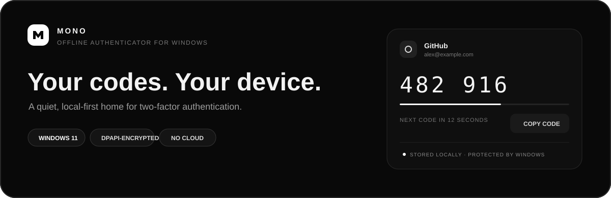
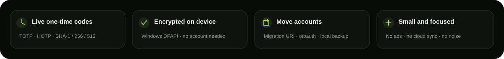

[Русский](README.md) · **English**

 

<a href="#features">Features</a> · <a href="#data-protection">Data protection</a> · <a href="#install">Install</a>

 

**Mono** is an offline Windows 11 app that keeps OTP accounts on your device and generates TOTP/HOTP codes. No sign-up or cloud sync.

## Features

- TOTP (RFC 6238) and HOTP (RFC 4226), SHA-1/SHA-256/SHA-512, 6 or 8 digits.
- Add, edit, delete, search, favorite and copy codes.
- Import `otpauth://` and Google Authenticator migration URIs, including multiple accounts in a protobuf payload.
- Import QR images from a file or clipboard, and encrypted or unencrypted Aegis JSON with a selectable preview.
- Encrypted local vault and encrypted backup.
- Optional master password, automatic lock and clipboard clearing.
- OLED black theme with a live code timer.

## Data protection

Secrets live in the local profile, protected by Windows DPAPI for the current Windows user. The app does not send account data over the network. Exported backups use a portable password-based AES-256-GCM + PBKDF2-SHA256 envelope.

## Install

1. Download and run `Mono-Setup.exe` from the [latest release](https://github.com/sailxx/Mono/releases/latest).
2. The installer creates Start menu and desktop shortcuts. Running it again updates the installed version; uninstall Mono from Windows Settings → Apps.

The installer includes the self-contained x64 app, Windows App SDK dependencies, and the bundled JetBrains Mono font. Account data stays outside the app folder and is preserved during updates and uninstall.

 
<b>MONO</b> · Local. Quiet. No cloud.

