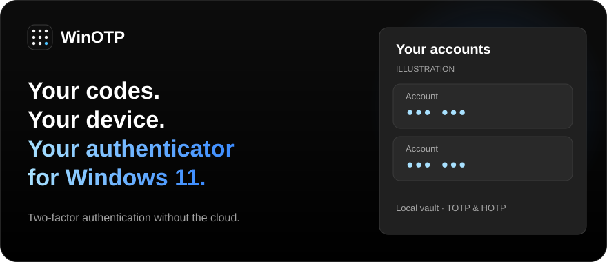
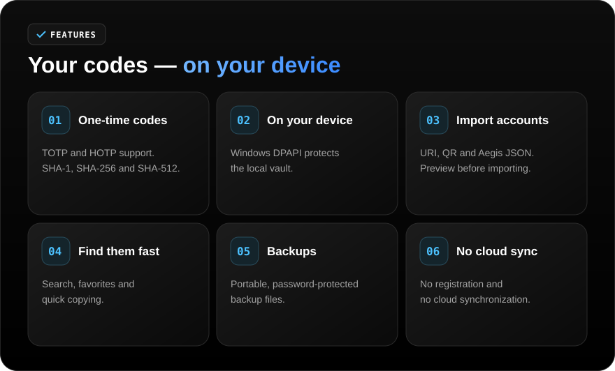

<div align="center">

[Русский](README.md) · **English**

<br>


<a href="https://github.com/sailxx/Mono/releases"></a>

</div>

<br>


**WinOTP**, formerly Mono, is a local authenticator for Windows 11. TOTP and HOTP codes, search and favorites, without registration or cloud sync.

<details>
<summary><b>Features</b></summary>

- RFC 6238 TOTP and RFC 4226 HOTP; SHA-1/256/512; 6 or 8 digits.
- Add, edit, remove, search, favorite and copy accounts and codes.
- Import otpauth URIs, Google Authenticator migration URIs, QR images and Aegis JSON.
- Preview imported accounts and skip existing entries.
- Password-encrypted `.winotp` backup files.
- Optional interface lock, idle timeout and clipboard clearing.

</details>

## Data protection

Windows DPAPI protects the vault for the current Windows user. Portable backups use AES-256-GCM and PBKDF2-SHA256 with 600,000 iterations. The master password locks the **interface**, not access by malware running as your Windows user. Clipboard clearing cannot erase clipboard history or copies captured by other apps.

Data lives in `%LOCALAPPDATA%\WinOTP`. Migration copies legacy files from `%LOCALAPPDATA%\NoirAuth` without removing the originals. Keep them until you have verified the migrated vault and a restorable backup. See [SECURITY.md](SECURITY.md).

## Install

Download the installer from [Releases](https://github.com/sailxx/Mono/releases). New builds use `WinOTP-Setup.exe`; older releases may still use Mono. Changing source files does not publish a new release.

No administrator rights are required. Data is separate from the application and is retained when uninstalling. The application interface and installer use English.

<details>
<summary><b>Verify release provenance and checksum</b></summary>

The release workflow produces `SHA256SUMS.txt` and a provenance attestation for new releases:

```powershell
cd C:\Users\Vlad\Downloads
gh attestation verify WinOTP-Setup.exe --repo sailxx/Mono
Get-FileHash .\WinOTP-Setup.exe -Algorithm SHA256
```

Compare the hash with the checksum from the same release. Provenance is not Windows code signing or a guarantee of vulnerability-free code.

</details>

## Build from source

Requires Windows, .NET SDK 10 and WinUI build tools. Internal project paths retain the Mono name for now.

```cmd
cd /d C:\Users\Vlad\sx\mono
dotnet run --project tests/OtpVectors/OtpVectors.csproj -c Release
dotnet build src/Mono/Mono.csproj -c Release
```

License: [LICENSE](LICENSE).
