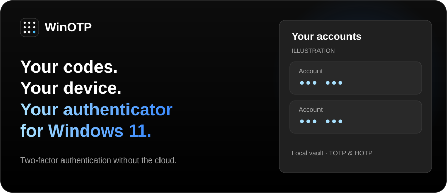
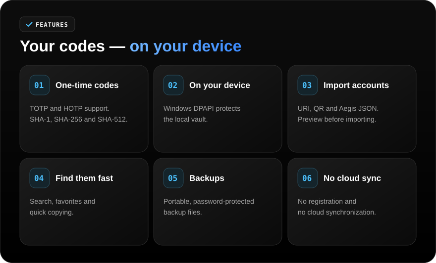

<div align="center">

**Русский** · [English](README.en.md)

<br>


<a href="https://github.com/sailxx/Mono/releases"></a>

</div>

<br>


**WinOTP** — локальный аутентификатор для Windows 11. Коды TOTP и HOTP, поиск и избранное, без регистрации и облачной синхронизации.

<details>
<summary><b>Возможности</b></summary>

- TOTP (RFC 6238), HOTP (RFC 4226), SHA-1/256/512, 6 или 8 цифр.
- Добавление, редактирование, удаление и копирование кодов.
- Импорт otpauth URI, Google Authenticator migration URI, QR-изображений и Aegis JSON.
- Предпросмотр импорта и исключение уже добавленных аккаунтов.
- Зашифрованный файл резервной копии `.winotp`, защищённый отдельным паролем.
- Блокировка интерфейса мастер-паролем, таймер бездействия и очистка буфера.

</details>

## Защита данных

Хранилище защищено Windows DPAPI текущего пользователя. Резервные копии используют AES-256-GCM и PBKDF2-SHA256 с 600 000 итерациями. Мастер-пароль блокирует **интерфейс**, но не защищает от вредоносной программы, запущенной под той же учётной записью Windows. Очистка буфера не удаляет копии из истории и сторонних приложений.

Данные находятся в `%LOCALAPPDATA%\WinOTP`. При переносе из `%LOCALAPPDATA%\NoirAuth` исходные файлы сохраняются. Не удаляйте их, пока не проверите новое хранилище и резервную копию. Подробности: [SECURITY.md](SECURITY.md).

## Установка

Скачайте установщик из [релизов](https://github.com/sailxx/Mono/releases). Новые сборки используют имя `WinOTP-Setup.exe`; старые релизы могут называться Mono. Переименование исходников само по себе не публикует новый релиз.

Установка не требует прав администратора. Данные хранятся отдельно от программы и сохраняются при удалении. Интерфейс приложения и установщик используют английский язык.

<details>
<summary><b>Проверка происхождения и контрольной суммы</b></summary>

Для новых релизов процесс сборки создаёт `SHA256SUMS.txt` и подтверждение происхождения:

```powershell
cd $HOME\Downloads
gh attestation verify WinOTP-Setup.exe --repo sailxx/Mono
Get-FileHash .\WinOTP-Setup.exe -Algorithm SHA256
```

Сравните хеш с файлом из того же релиза. Подтверждение происхождения не заменяет подпись Windows и не гарантирует отсутствие уязвимостей.

</details>

## Сборка из исходников

Нужны Windows, .NET SDK 10 и инструменты сборки WinUI. Замените путь в первой команде на папку проекта.

```cmd
cd /d C:\path\to\project
dotnet run --project tests/OtpVectors/OtpVectors.csproj -c Release
dotnet build src/WinOTP/WinOTP.csproj -c Release
```

Лицензия: [LICENSE](LICENSE).
