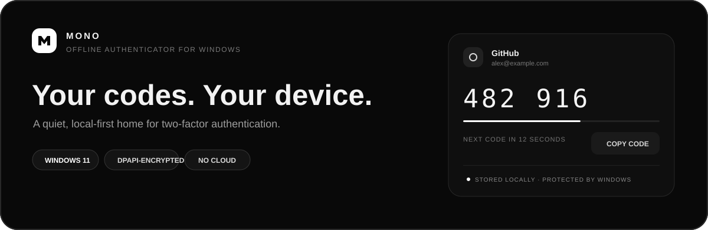
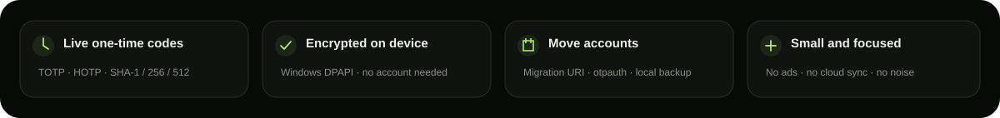

**Русский** · [English](README.en.md)

 

<a href="#возможности">Возможности</a> · <a href="#защита-данных">Защита данных</a> · <a href="#установка">Установка</a>

 

**Mono** — автономное приложение для Windows 11, которое хранит OTP-аккаунты на устройстве и генерирует коды TOTP/HOTP. Регистрация и облачная синхронизация не нужны.

## Возможности

- TOTP (RFC 6238) и HOTP (RFC 4226), SHA-1/SHA-256/SHA-512, 6 или 8 цифр.
- Добавление, редактирование, удаление, поиск, избранное, копирование кода.
- Импорт `otpauth://` и Google Authenticator migration URI, включая несколько записей в одном protobuf payload.
- Импорт QR-картинок из файла/буфера обмена, незашифрованных и зашифрованных Aegis JSON с предпросмотром выбора записей.
- Зашифрованное локальное хранилище и зашифрованная резервная копия.
- Необязательный мастер-пароль, автоблокировка и очистка скопированного кода из буфера.
- Чёрная OLED-тема и обновление оставшегося времени кода.

## Защита данных

Секреты сохраняются в файле локального профиля, зашифрованном Windows DPAPI для текущей учётной записи. Приложение не отправляет данные аккаунтов в сеть. Экспортируемая резервная копия защищена паролем AES-256-GCM + PBKDF2-SHA256 и переносима между профилями.

## Установка

1. Скачайте и запустите `Mono-Setup.exe` из [последнего релиза](https://github.com/sailxx/Mono/releases/latest).
2. Установщик создаст ярлыки в меню «Пуск» и на рабочем столе. При повторном запуске он обновит установленную версию; удаление доступно в параметрах Windows → Приложения.

Установщик содержит автономную сборку x64, зависимости Windows App SDK и версию JetBrains Mono, используемую интерфейсом. Данные аккаунтов хранятся отдельно от папки приложения и сохраняются при обновлении и удалении.

 

<b>MONO</b> · Локально. Спокойно. Без облака.

